<h1 align="center">BizOS Charts</h1>

<p align="center"><strong>Research-grade charts and complete reports, rendered offline from your data.</strong></p>

<p align="center"><b>English</b> · <a href="README.zh-CN.md">简体中文</a></p>

<p align="center">
  <a href="https://github.com/bizos-ai/bizos-charts/stargazers"></a>
  <a href="https://github.com/bizos-ai/bizos-charts/releases/latest"></a>
  <a href="LICENSE"></a>
  <a href=".nvmrc"></a>
  <a href="#why-bizos-charts"></a>
  <a href="#the-64-type-gallery"></a>
  <a href="#six-report-layouts"></a>
</p>

<p align="center">
  
</p>

<p align="center"><a href="#the-64-type-gallery">Gallery</a> · <a href="#six-report-layouts">Reports</a> · <a href="#quick-start">Quick start</a> · <a href="#install-the-skill">Install the skill</a> · <a href="#javascript-api">API</a> · <a href="CONTRIBUTING.md">Contributing</a> · <a href="LICENSE">License</a></p>

**BizOS Charts** (public package **2.1.2**, renderer **2.1.0**) is a charting skill for agents and a dependency-free rendering engine. It turns a JSON specification into a finished exhibit (number, conclusion title, subtitle, plot, units, notes, source and the underlying data) and assembles exhibits into complete reports. The output is one offline HTML file with SVG graphics, data inspection and SVG, PNG and CSV exports, in English or Chinese.

## Why BizOS Charts

<table>
<tr>
<td width="50%" valign="top">

**Conclusion-first exhibits.** Each title states the finding. Units, notes, sources, estimate markers and the data table stay attached to the figure, in a restrained research house style: light pages, white exhibit cards, tabular numbers and direct labels. A custom primary color or a monochrome palette changes the look without changing the data contract.

</td>
<td width="50%" valign="top">

**Offline and portable.** Generated HTML embeds its engine, styles and data and never loads scripts, fonts, map files or data from a CDN. Rendering, opening, inspecting and exporting need no account, API key or network connection.

</td>
</tr>
<tr>
<td valign="top">

**Rules that refuse to render.** Rendering stops on missing sources or required units, truncated bar axes, estimates placed before actuals, inconsistent bridges, negative composition values, and invalid scientific intervals or P values. Warnings stay visible for review.

</td>
<td valign="top">

**Statistics computed from observations.** Welch and paired t-tests, Mann–Whitney, multiple-comparison adjustment, Kaplan–Meier and log-rank, ROC with DeLong intervals, four-parameter logistic fits, inverse-variance meta-analysis and hierarchical clustering are calculated by the engine and returned in `stats`.

</td>
</tr>
</table>

## The 64-type gallery

Every card is the engine's own SVG output for the bundled sample in [`examples/specs`](skills/bizos-charts/examples/specs), with a short entrance animation added for this page; readers who prefer reduced motion see the finished chart. Sample data are illustrative. Select a card to open it at full size, and see the [chart catalog](skills/bizos-charts/catalog.md) for when each type fits and what to use instead.

<!-- gallery:start -->
| Group | Types | Count |
|---|---|---:|
| [Trends over time](#trends-over-time) | T01–T11 · M01 | 12 |
| [Comparison, relationships and matrices](#comparison-relationships-and-matrices) | C01–C07 · R01–R03 · H01–H02 | 12 |
| [Composition and bridges](#composition-and-bridges) | S01–S08 | 8 |
| [Valuation and sensitivity](#valuation-and-sensitivity) | V01–V04 | 4 |
| [KPIs and tables](#kpis-and-tables) | K01–K04 | 4 |
| [Maps and schedules](#maps-and-schedules) | G01–G02 · P01–P02 | 4 |
| [Distributions and statistics](#distributions-and-statistics) | D01–D03 · E01–E09 | 12 |
| [Biomedicine and omics](#biomedicine-and-omics) | B01–B08 | 8 |
| **Total** | | **64** |

### Trends over time

<sub>T01–T11 Trend & time · M01 Small multiples · 12 types</sub>

Follow a metric through time: turning points, forecasts, prices, valuation bands, seasonality and rank changes.

<p>
</p>

<details><summary>What each type answers</summary>

| ID | Chart | The question it answers | Sample |
|---|---|---|---|
| T01 | Line chart | How does a metric move over time, and which series turns first? | [JSON](skills/bizos-charts/examples/specs/T01-line.json) |
| T02 | Area / stacked area | How does a total evolve and which components drive it; is the mix shifting? | [JSON](skills/bizos-charts/examples/specs/T02-area.json) |
| T03 | Bars + rate line (dual axis) | Is the business growing, and is growth or margin accelerating? | [JSON](skills/bizos-charts/examples/specs/T03-combo.json) |
| T04 | Indexed performance (rebased = 100) | From a common start, which series of different scale performed better? | [JSON](skills/bizos-charts/examples/specs/T04-indexed.json) |
| T05 | Fan / range chart | Where is the central forecast and how wide is the uncertainty? | [JSON](skills/bizos-charts/examples/specs/T05-fan.json) |
| T06 | Candlestick with volume | What were open, high, low and close each period, and did volume confirm? | [JSON](skills/bizos-charts/examples/specs/T06-candle.json) |
| T07 | Valuation band (PE / PB band) | Which historical multiple does the current price imply; where in the band is it? | [JSON](skills/bizos-charts/examples/specs/T07-peband.json) |
| T08 | Calendar heatmap | What weekday and seasonal patterns show up day by day, and which days are outliers? | [JSON](skills/bizos-charts/examples/specs/T08-calendar.json) |
| T09 | Slope chart (two periods) | Between two points in time, which items rose or fell and did ranks cross? | [JSON](skills/bizos-charts/examples/specs/T09-slope.json) |
| T10 | Bump chart (rank over time) | How do ranks change over time; who is climbing and who is slipping? | [JSON](skills/bizos-charts/examples/specs/T10-bump.json) |
| T11 | Seasonality overlay | How does this year compare with prior years at the same point; where are seasonal peaks? | [JSON](skills/bizos-charts/examples/specs/T11-seasonality.json) |
| M01 | Small multiples | Does the same metric behave alike across many items (marketplaces, categories, SKUs)? | [JSON](skills/bizos-charts/examples/specs/M01-small.json) |

</details>

### Comparison, relationships and matrices

<sub>C01–C07 Comparison & ranking · R01–R03 Relationship & positioning · H01–H02 Matrix & cohort · 12 types</sub>

Rank entities, compare before and after, place them on two measures, and read two-way matrices and cohorts.

<p>
</p>

<details><summary>What each type answers</summary>

| ID | Chart | The question it answers | Sample |
|---|---|---|---|
| C01 | Bar chart (ranked) | Who is largest or smallest; where does the subject rank against the median? | [JSON](skills/bizos-charts/examples/specs/C01-bar.json) |
| C02 | Column chart | How large is each period or category, which is highest, what do estimates show? | [JSON](skills/bizos-charts/examples/specs/C02-column.json) |
| C03 | Grouped bars | Within each category, how do 2–4 series (this year vs last, us vs peers) compare? | [JSON](skills/bizos-charts/examples/specs/C03-grouped.json) |
| C04 | Diverging bar | Which items grew and which declined, and by how much? | [JSON](skills/bizos-charts/examples/specs/C04-diverging.json) |
| C05 | Dumbbell (before / after) | How far did each category move from A to B; is the gap widening? | [JSON](skills/bizos-charts/examples/specs/C05-dumbbell.json) |
| C06 | Bullet chart (actual vs target) | How far is each metric against target, and in which performance band? | [JSON](skills/bizos-charts/examples/specs/C06-bullet.json) |
| C07 | Range bar | Where does each item’s range sit, where is the typical value and our position? | [JSON](skills/bizos-charts/examples/specs/C07-range.json) |
| R01 | Scatter (with fit) | Are two metrics related, and who deviates from the pattern? | [JSON](skills/bizos-charts/examples/specs/R01-scatter.json) |
| R02 | Bubble chart | Beyond position on two metrics, how big is each item on a third? | [JSON](skills/bizos-charts/examples/specs/R02-bubble.json) |
| R03 | Quadrant matrix (2×2) | Which of four strategic quadrants does each item fall into on two dimensions? | [JSON](skills/bizos-charts/examples/specs/R03-quadrant.json) |
| H01 | Heatmap matrix | Across two dimensions, which combinations are highest or lowest, and is there a pattern? | [JSON](skills/bizos-charts/examples/specs/H01-heatmap.json) |
| H02 | Cohort retention triangle | Of customers acquired each month, how many remain or repurchase later; is cohort quality improving? | [JSON](skills/bizos-charts/examples/specs/H02-cohort.json) |

</details>

### Composition and bridges

<sub>S01–S08 Composition & bridges · 8 types</sub>

Show what a total is made of, how the mix shifts, and how one result bridges to another.

<p>
</p>

<details><summary>What each type answers</summary>

| ID | Chart | The question it answers | Sample |
|---|---|---|---|
| S01 | Stacked bars | How big is the total, what is it made of, and which part is changing? | [JSON](skills/bizos-charts/examples/specs/S01-stacked.json) |
| S02 | 100% stacked (mix) | How does the mix (share) differ across periods or groups? | [JSON](skills/bizos-charts/examples/specs/S02-mix.json) |
| S03 | Waterfall / bridge | From start to end, how much did each driver add or subtract? | [JSON](skills/bizos-charts/examples/specs/S03-waterfall.json) |
| S04 | Donut (≤6 parts) | What makes up one whole, and how big is the largest part? | [JSON](skills/bizos-charts/examples/specs/S04-donut.json) |
| S05 | Treemap | Within one total, which categories and sub-categories take the most? | [JSON](skills/bizos-charts/examples/specs/S05-treemap.json) |
| S06 | Marimekko (market map) | How large is each segment, and who holds what share within it? | [JSON](skills/bizos-charts/examples/specs/S06-mekko.json) |
| S07 | Sankey (flows) | Where does the total come from, where does it go, and how does it split at each stage? | [JSON](skills/bizos-charts/examples/specs/S07-sankey.json) |
| S08 | Conversion funnel | How much is lost at each step from impression to order; which step converts worst? | [JSON](skills/bizos-charts/examples/specs/S08-funnel.json) |

</details>

### Valuation and sensitivity

<sub>V01–V04 Valuation & sensitivity · 4 types</sub>

Compare valuation methods, test assumptions, rank the drivers of an outcome and decompose a metric.

<p>
</p>

<details><summary>What each type answers</summary>

| ID | Chart | The question it answers | Sample |
|---|---|---|---|
| V01 | Valuation football field | What value range does each method imply, and how does it compare with the current price or offer? | [JSON](skills/bizos-charts/examples/specs/V01-football.json) |
| V02 | Sensitivity table (two-way) | When two key assumptions move together, where does the outcome land? | [JSON](skills/bizos-charts/examples/specs/V02-sensitivity.json) |
| V03 | Tornado (one-way sensitivity) | Which assumption moves the outcome most when each is flexed up and down? | [JSON](skills/bizos-charts/examples/specs/V03-tornado.json) |
| V04 | Driver tree | Which drivers multiply or add up to the outcome, and where did the change come from? | [JSON](skills/bizos-charts/examples/specs/V04-driver.json) |

</details>

### KPIs and tables

<sub>K01–K04 KPIs & tables · 4 types</sub>

Headline metrics with trends, detail tables with inline bars, peer comparables and forecast models.

<p>
</p>

<details><summary>What each type answers</summary>

| ID | Chart | The question it answers | Sample |
|---|---|---|---|
| K01 | KPI tiles | What are the headline metrics this period, how did they change, and is that good or bad? | [JSON](skills/bizos-charts/examples/specs/K01-kpi.json) |
| K02 | Data table (bars, heat, sparklines) | How to give exact values across many metrics at once, with emphasis? | [JSON](skills/bizos-charts/examples/specs/K02-table.json) |
| K03 | Comparable companies table | Where do the subject’s multiples, growth and margins sit against the peer mean and median? | [JSON](skills/bizos-charts/examples/specs/K03-comps.json) |
| K04 | Financial forecast table (A/E) | What are revenue, profit, margins and valuation metrics across actual and estimate years? | [JSON](skills/bizos-charts/examples/specs/K04-forecast.json) |

</details>

### Maps and schedules

<sub>G01–G02 Geography · P01–P02 Process & timeline · 4 types</sub>

Equal-area tile maps of the US and China, milestones and project plans.

<p>
</p>

<details><summary>What each type answers</summary>

| ID | Chart | The question it answers | Sample |
|---|---|---|---|
| G01 | US state tile map | How do state-level values (sales, orders, penetration) vary, and are they regionally concentrated? | [JSON](skills/bizos-charts/examples/specs/G01-us.json) |
| G02 | China province tile map | How do province-level values (sellers, factories, sales) vary, and where do they concentrate? | [JSON](skills/bizos-charts/examples/specs/G02-china.json) |
| P01 | Event timeline | In what order did key events happen, and how far apart? | [JSON](skills/bizos-charts/examples/specs/P01-timeline.json) |
| P02 | Gantt chart | When does each workstream start and finish; what overlaps or slips? | [JSON](skills/bizos-charts/examples/specs/P02-gantt.json) |

</details>

### Distributions and statistics

<sub>D01–D03 Distribution · E01–E09 Experiments & statistics · 12 types</sub>

Distributions, group tests, experimental curves, meta-analysis, diagnostic accuracy, agreement and set overlaps, with statistics computed from the supplied observations.

<p>


</p>

<details><summary>What each type answers</summary>

| ID | Chart | The question it answers | Sample |
|---|---|---|---|
| D01 | Histogram | Where do values cluster; is the distribution skewed or long-tailed? | [JSON](skills/bizos-charts/examples/specs/D01-histogram.json) |
| D02 | Box plot | How do medians, spread and outliers differ across groups? | [JSON](skills/bizos-charts/examples/specs/D02-box.json) |
| D03 | Strip / beeswarm | Where does every observation fall, and where do the highlighted items sit? | [JSON](skills/bizos-charts/examples/specs/D03-strip.json) |
| E01 | Group comparison (dots + error bars) | How large are the differences between experimental groups, and do they hold statistically? | [JSON](skills/bizos-charts/examples/specs/E01-groups.json) |
| E02 | Violin / raincloud plot | How do distribution shapes (bimodality, skew, tails) differ across groups? | [JSON](skills/bizos-charts/examples/specs/E02-violin.json) |
| E03 | Experimental curves (mean ± error) | How does a measurement change with time, dose or temperature in each group, and when do groups diverge? | [JSON](skills/bizos-charts/examples/specs/E03-curve.json) |
| E04 | Forest plot | What are the effect sizes and confidence intervals across studies or subgroups, and does the pooled effect hold consistently? | [JSON](skills/bizos-charts/examples/specs/E04-forest.json) |
| E05 | ROC / precision–recall curve | How well does a test or model separate positives from negatives, and which model is better? | [JSON](skills/bizos-charts/examples/specs/E05-roc.json) |
| E06 | Bland–Altman agreement | Do two measurement methods agree: how large is the mean bias and where do 95% of differences fall? | [JSON](skills/bizos-charts/examples/specs/E06-blandaltman.json) |
| E07 | Q-Q plot | Are data (or residuals) normal; are association P values inflated overall? | [JSON](skills/bizos-charts/examples/specs/E07-qq.json) |
| E08 | Correlation matrix | How strongly and in which direction are variables pairwise correlated, and which correlations hold statistically? | [JSON](skills/bizos-charts/examples/specs/E08-corr.json) |
| E09 | Set intersections (UpSet) | How many elements fall in each intersection of several sets (e.g. overlapping gene lists)? | [JSON](skills/bizos-charts/examples/specs/E09-upset.json) |

</details>

### Biomedicine and omics

<sub>B01–B08 Biomedicine & omics · 8 types</sub>

Survival, dose–response, differential expression, association studies, clustering, embeddings, phylogenies and mutations.

<p>


</p>

<details><summary>What each type answers</summary>

| ID | Chart | The question it answers | Sample |
|---|---|---|---|
| B01 | Survival curve (Kaplan–Meier) | How does the survival (or event-free) proportion fall by group, and how far apart are the median times? | [JSON](skills/bizos-charts/examples/specs/B01-survival.json) |
| B02 | Dose–response curve (IC50 / EC50) | How potent is each compound (IC50 / EC50), and which is strongest? | [JSON](skills/bizos-charts/examples/specs/B02-dose.json) |
| B03 | Volcano / MA plot | Which genes (proteins, metabolites) are significantly up- or down-regulated, and by how much? | [JSON](skills/bizos-charts/examples/specs/B03-volcano.json) |
| B04 | Manhattan plot (GWAS) | Which loci across the genome are significantly associated with the trait, and on which chromosomes? | [JSON](skills/bizos-charts/examples/specs/B04-manhattan.json) |
| B05 | Clustered heatmap | How do samples and genes cluster by expression profile, and which genes are high in which samples? | [JSON](skills/bizos-charts/examples/specs/B05-heatmap.json) |
| B06 | Embedding (PCA / UMAP / t-SNE) | How do samples or cells group by overall profile, and do treatment and control separate? | [JSON](skills/bizos-charts/examples/specs/B06-embedding.json) |
| B07 | Phylogenetic tree / dendrogram | How are species, strains or samples related, which form clades, and how well supported are they? | [JSON](skills/bizos-charts/examples/specs/B07-tree.json) |
| B08 | Mutation lollipop | Where do mutations fall along the protein, and do they cluster in a domain or hotspot? | [JSON](skills/bizos-charts/examples/specs/B08-lollipop.json) |

</details>
<!-- gallery:end -->

The skill checks whether the data supports the chosen encoding: it does not invent Sankey paths from aggregate edges or treat overlapping percentages as parts of one whole. Model-derived quantities that the engine does not fit, such as a hazard ratio from a Cox model, must come from a real analysis and keep their method information. Rule checks validate a specification; they do not establish that the input data or an analytical claim is correct, so review study design, assumptions and test selection before relying on a result.

## Six report layouts

A report specification arranges evidence into sections with numbered exhibits and one shared visual system. The same chart contracts work in every layout.

<p align="center">
  
</p>

| Layout | Best suited to | Samples |
|---|---|---|
| **Research note** | Company, industry, category or investment research that builds an evidence-based argument | [EN](skills/bizos-charts/templates/reports/research-note.en.html) · [中文](skills/bizos-charts/templates/reports/research-note.zh.html) |
| **Business review** | Monthly or quarterly performance, drivers and next actions | [EN](skills/bizos-charts/templates/reports/business-review.en.html) · [中文](skills/bizos-charts/templates/reports/business-review.zh.html) |
| **One-pager** | A compact category overview or executive briefing | [EN](skills/bizos-charts/templates/reports/one-pager.en.html) · [中文](skills/bizos-charts/templates/reports/one-pager.zh.html) |
| **Dashboard** | A recurring overview of a consistent set of metrics | [EN](skills/bizos-charts/templates/reports/dashboard.en.html) · [中文](skills/bizos-charts/templates/reports/dashboard.zh.html) |
| **Decision memo** | One decision with its evidence and a clear recommendation | [EN](skills/bizos-charts/templates/reports/decision-memo.en.html) · [中文](skills/bizos-charts/templates/reports/decision-memo.zh.html) |
| **Study report** | Research results with methods, statistics and limitations | [EN](skills/bizos-charts/templates/reports/study-report.en.html) · [中文](skills/bizos-charts/templates/reports/study-report.zh.html) |

The report samples and the [English](skills/bizos-charts/templates/gallery.en.html) and [Chinese](skills/bizos-charts/templates/gallery.zh.html) atlases are self-contained HTML files. Download them or clone the repository and open them locally; the repository file viewer shows HTML source. The report engine formats the evidence supplied in a specification. It does not retrieve live data, schedule monitoring or make a business or clinical decision on its own.

## Quick start

You need Node.js. Generated assets and validation were built with **Node.js 22.17.0**, recorded in `.nvmrc`. Use that version when checking generated files byte for byte; JavaScript runtime differences can change the last digits of calculated statistics.

```bash
git clone https://github.com/bizos-ai/bizos-charts.git
cd bizos-charts/skills/bizos-charts

# Render an existing example in English.
node scripts/render.mjs \
  --spec examples/specs/T01-line.json \
  --lang en \
  --out ../../output/sales-trend.html

# Export the same exhibit as vector artwork.
node scripts/render.mjs \
  --spec examples/specs/T01-line.json \
  --lang en \
  --svg ../../output/sales-trend.svg

# Render a complete report.
node scripts/render.mjs \
  --report examples/reports/business-review.json \
  --lang en \
  --out ../../output/business-review.html
```

The renderer exits with a nonzero status when errors remain. `--strict` also fails on warnings. HTML and SVG rendering require no npm install.

### Write your own specification

Save this as `revenue.json`. The sample title can be verified directly: revenue rises from 100 to 160, an increase of 60%.

```json
{
  "type": "T01",
  "lang": "en",
  "title": "Revenue grew 60% from 2023 to 2025",
  "subtitle": "Annual revenue (US$ million), 2023–2025",
  "unit": "US$ million",
  "x": "year",
  "y": "revenue",
  "names": { "revenue": "Revenue" },
  "data": [
    { "year": "2023", "revenue": 100 },
    { "year": "2024", "revenue": 125 },
    { "year": "2025", "revenue": 160 }
  ],
  "source": "Illustrative example data"
}
```

```bash
node scripts/render.mjs --check revenue.json
node scripts/render.mjs --spec revenue.json --out revenue.html
```

The [specification reference](skills/bizos-charts/references/spec-reference.md) describes fields and per-type options. Percentages use percentage units: `12.5` means `12.5%`. Missing observations remain `null`; they must not be replaced with zero. Labels ending in `E`, such as `2026E`, mark estimates. Keep each output in one language; bilingual delivery uses two complete versions.

For statistical exhibits, run `--check` first, inspect the returned `stats`, then use those values in the title and accompanying text. For ordinary charts, independently reconcile title calculations to the input data; the renderer cannot prove an arbitrary sentence.

## Install the skill

Copy the complete `skills/bizos-charts` folder into the skills directory supported by your agent environment. Preserve the folder name and include its engine, scripts, references, examples and templates.

For an environment using `~/.agents/skills`:

```bash
mkdir -p ~/.agents/skills
cp -R skills/bizos-charts ~/.agents/skills/bizos-charts
```

Use this command for a fresh destination. If the skill is already installed, back it up and replace the entire folder so obsolete files are not mixed into the new version. Hosts with a different skills directory should use that directory instead. Discovery and explicit invocation depend on the host; the engine also works without an agent integration.

Example requests:

> Turn this monthly revenue file into an English exhibit. Compare the three regions, show the turning point, and include the data table and source.

> Build a quarterly business review from these metrics. Explain the revenue-to-profit bridge and identify the evidence behind the next actions.

> Render these censored survival observations with a risk table. State the method, show sample sizes, and use the calculated statistics in the caption.

## JavaScript API

```js
const fs = require('node:fs');
const charts = require('./skills/bizos-charts/engine/bizos-charts.js');
const spec = JSON.parse(fs.readFileSync('revenue.json', 'utf8'));

const issues = charts.lint(spec);
if (issues.some(issue => issue.level === 'error')) {
  throw new Error(JSON.stringify(issues));
}

const result = charts.render(spec, { width: 760 });
console.log(result.html);
console.log(result.stats);
```

`render()` returns exhibit markup. Use the CLI for a complete standalone page, or `exhibitsPage()` with the embedded engine source when building a multi-exhibit document. In a browser, the same built file exposes `BizosCharts`. The `catalog()` and `stats` APIs are available for selection and supported calculations.

## Inspect, export and validate

Generated pages support responsive redraw, hover values, data tables, and SVG, PNG and CSV exports. Table and KPI exhibits render as HTML; the CLI's `--svg` option is for SVG-based chart types. Exported graphics keep the exhibit context instead of leaving the title, units or source behind.

From the skill directory:

```bash
node scripts/find-chart.mjs \
  --query "monthly revenue by region" --fields time,measure

node scripts/build.mjs
node scripts/validate.mjs

# Optional real-browser validation at 1280px and 390px.
node scripts/verify.mjs ../../output/sales-trend.html
```

Browser validation requires the optional `playwright-core` module and a local Chrome or Edge executable. Install `playwright-core` in the skill directory or set `BIZOS_PLAYWRIGHT_CORE` to its module path; use `--chrome` to specify a browser executable. The check looks for page errors, non-local requests, empty exhibits, horizontal overflow, undersized chart text and overlapping text. If no browser is available, it reports `unverified` and exits with code 3; this does not count as a browser pass.

The initial release was checked with all **64 sample specifications in two languages at two rendering widths: 256 sample renders**. The English and Chinese atlases and report templates were also checked in a real browser at desktop and mobile widths. Supported checks are useful evidence, not a substitute for inspecting a real output with your own data.

## Repository structure

```text
skills/bizos-charts/
  SKILL.md                   skill workflow and essential rules
  engine/src/                maintained engine sources
  engine/bizos-charts.js     built offline engine
  catalog.md                 generated chart catalog
  report-catalog.md          six report layouts
  references/                selection, style, contracts, delivery checks
  examples/specs/            one sample for each of the 64 types
  examples/reports/          one sample for each report layout
  templates/                 English and Chinese atlases and reports
  scripts/                   build, render, search and validation helpers
docs/media/                  animated SVG media for the two READMEs
tools/render-readme-media.mjs  regenerates docs/media and the README galleries
```

Catalogs and specifications contain English chart names and field descriptions alongside Chinese guidance. The skill entry point is in English, this introduction is available in [English](README.md) and [Chinese](README.zh-CN.md), and the engine renders complete English or Chinese outputs.

## Contributing and license

See [CONTRIBUTING.md](CONTRIBUTING.md) for the source/build workflow and validation requirements. Keep chart changes in `engine/src/`, add a meaningful sample for a new type, and rebuild generated artifacts. Changes should preserve accurate encodings, clear methods, inspectable data and offline output.

BizOS Charts is released under the [Apache License 2.0](LICENSE), copyright 2026 BIZOS. You may use, modify and redistribute it, including commercially, under its terms.
