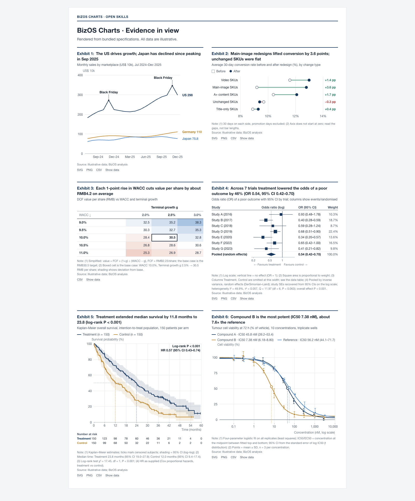
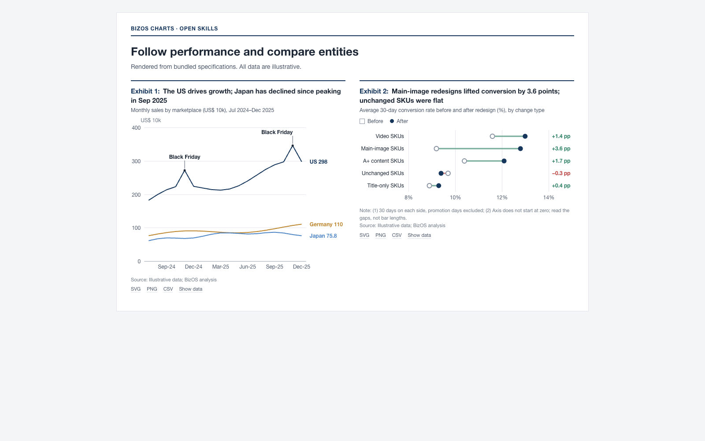
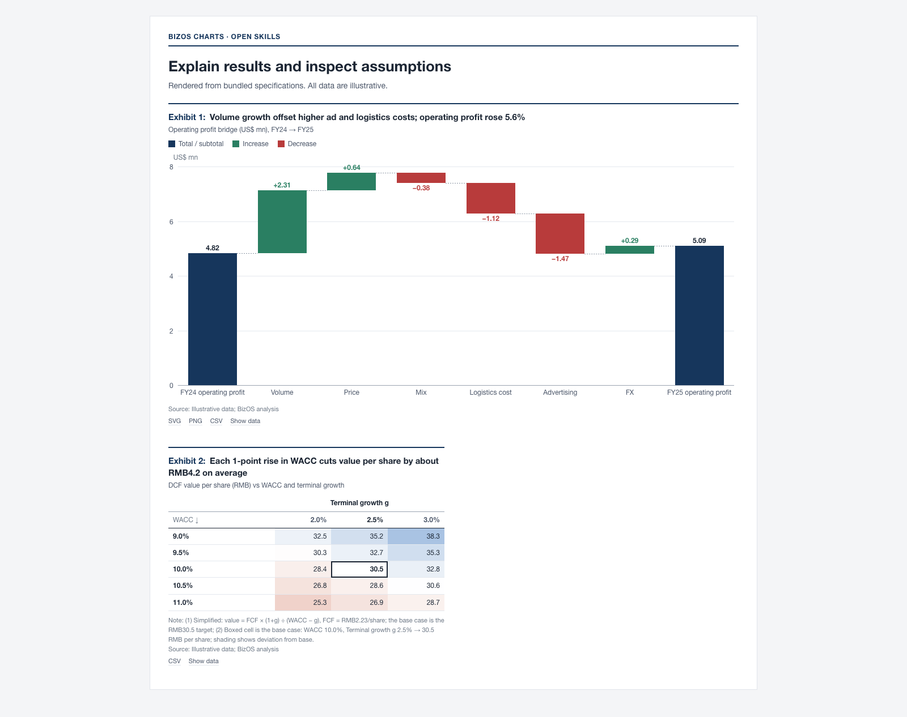
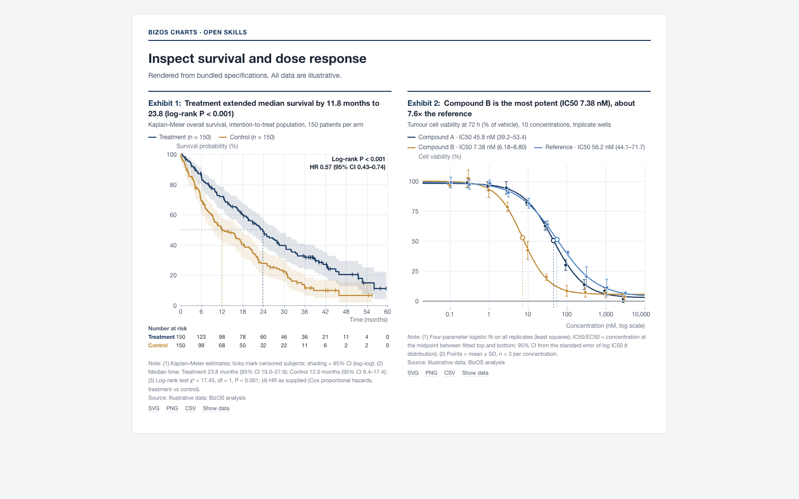
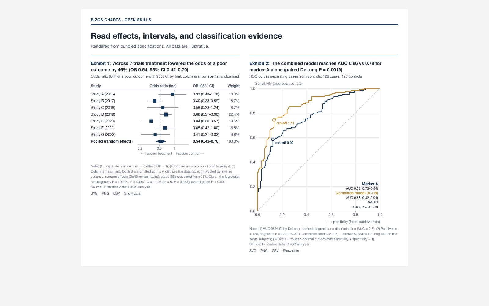
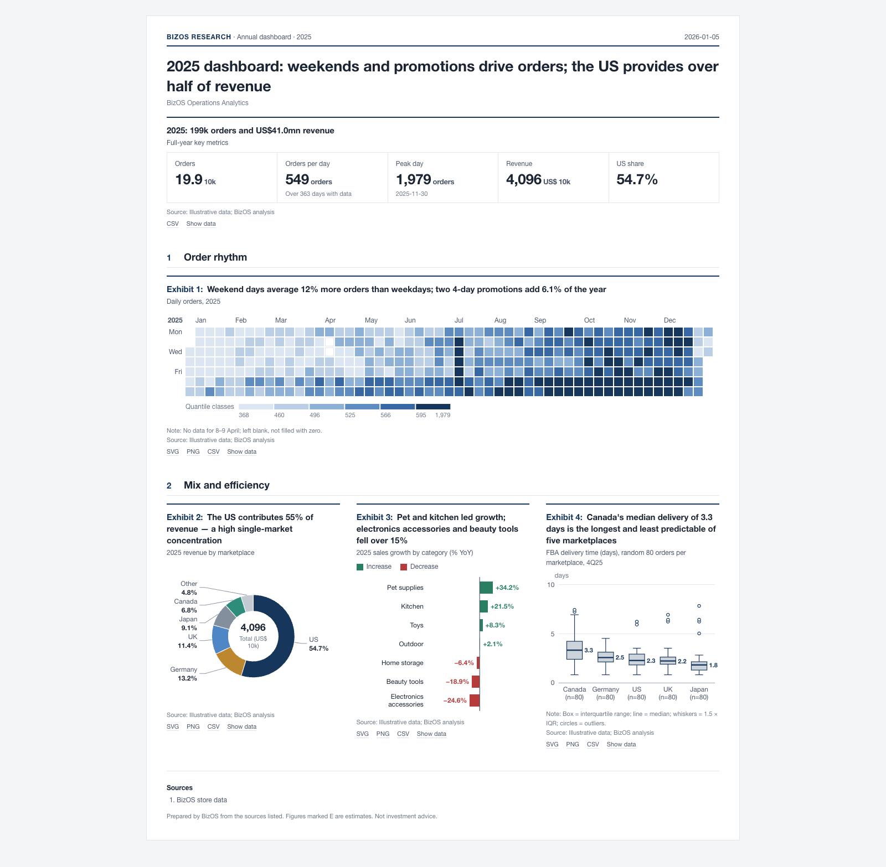

# BizOS Open Skills

Open-source skills for turning evidence into clear, inspectable business and research outputs.

The featured skill is **BizOS Charts** (public package **2.1.1**, renderer **2.1.0**): a charting skill, a dependency-free rendering engine, **64 exhibit types**, and **6 complete report layouts**. It produces offline HTML with SVG graphics, readable source notes, inspectable data tables, and SVG, PNG, and CSV exports.



*Actual engine output. All figures and reports in this introduction use illustrative data, not live business or clinical results.*

## Available skills

| Skill | What it does | Entry point |
|---|---|---|
| **bizos-charts** | Selects, validates, and renders business, financial, experimental, and biomedical exhibits; assembles complete reports | [Skill instructions](skills/bizos-charts/SKILL.md) · [Package guide](skills/bizos-charts/README.md) |

Each skill is a self-contained folder under `skills/`. The collection can grow without requiring users to install unrelated capabilities. This repository contains the standalone chart engine and its documentation; private application templates, account services, and application release infrastructure are outside its scope.

## What BizOS Charts gives you

**An analytical workflow and an executable renderer.** The skill guides the selection of a chart by the question, available fields, units, and audience. The engine turns a JSON specification into an exhibit with a number, conclusion title, subtitle, plot, notes, source, and underlying data. The same specifications can be rendered from the command line or used through the JavaScript API.

**A consistent research style.** Light gray pages, white exhibit cards, dark text, restrained series colors, tabular numbers, and explicit units keep attention on the evidence. Forecast periods use visual distinctions from actual observations. Custom primary colors and a monochrome palette are available without changing the data contract.

**Portable output.** Generated HTML embeds its engine, styles, and data. It does not fetch scripts, fonts, map files, or chart data from a CDN. A recipient can open the file locally, inspect the data, and export a figure. Rendering does not require a hosted account, an API key, or a network connection.

**Built-in checks.** Rendering stops when a specification breaks supported rules: missing sources, missing required units, truncated bar axes, invalid actual/estimate ordering, inconsistent bridges, negative composition values, or invalid scientific intervals and P values. Warnings remain visible for review. These checks validate the supported specification rules; they do not establish that the input data or an analytical claim is correct.

## A visual tour

### Follow performance over time

Trend exhibits cover lines, areas, bars with rate overlays, indexed series, forecast fans, OHLC, valuation bands, calendars, slopes, ranking changes, and seasonality. Use them to distinguish recurring changes, turning points, and differences between entities. Direct labels, axis units, and source lines remain part of the exhibit.



*The examples compare marketplace sales and show how entities differ. The titles state a specific conclusion supported by the sample values.*

### Explain where a result comes from

Composition and bridge charts connect headline results to their components. A waterfall can explain the route from revenue to profit; a stacked view can show a changing mix; a Sankey can represent supplied flows. The skill checks whether the available data supports the selected encoding. It does not invent paths from aggregate edges or treat overlapping percentages as a mutually exclusive whole.



*A bridge explains the components of a result. A sensitivity matrix compares explicitly supplied assumptions and outcomes; it is not a forecasting model.*

### Inspect experimental and biomedical evidence

Scientific exhibits include group comparisons, violin plots, experimental curves, forest plots, ROC and precision–recall curves, Bland–Altman plots, Q-Q plots, correlation matrices, and UpSet views. Biomedical exhibits add survival curves, dose–response fits, volcano and MA plots, Manhattan plots, clustered heatmaps, embeddings, phylogenetic trees, and mutation lollipops.

The engine computes supported statistics from supplied observations, returns them in `stats`, and adds method notes to the figure. Available methods include Welch and paired t-tests, Mann–Whitney, multiple-comparison adjustment, Kaplan–Meier and log-rank, ROC with DeLong intervals, four-parameter logistic fitting, inverse-variance meta-analysis, and hierarchical clustering. Model-derived quantities that the engine does not fit must come from a real external analysis and retain their method information.



*Illustrative survival and dose–response data demonstrate the display and calculation workflow. Review study design, assumptions, censoring, and test selection before using results in a real analysis.*



*Intervals, reference values, and method notes are part of the output. Quote calculated quantities from `stats` so that titles and figures agree.*

### Assemble a complete report

Report specifications organize evidence into sections, with numbered exhibits and a shared visual system. A report can use a different layout without changing the underlying chart contracts.



| Layout | Best suited to |
|---|---|
| **Research note** | Company, industry, category, or investment research that develops an evidence-based argument |
| **Business review** | Monthly or quarterly performance, drivers, and next actions |
| **One-pager** | A compact category overview or executive briefing |
| **Dashboard** | A recurring overview of a consistent set of metrics |
| **Decision memo** | A specific decision with evidence and a clear recommendation |
| **Study report** | Research results with methods, statistics, and limitations |

The report engine formats the evidence supplied in a specification. It does not retrieve live data, schedule monitoring, or make a business or clinical decision independently.

## The 64-type chart library

| Family | Types | Representative exhibits |
|---|---:|---|
| Trend & time | 11 | Line, area, bar/line combination, forecast fan, OHLC, calendar, slope, seasonality |
| Comparison & ranking | 7 | Bars, columns, grouped comparisons, diverging bars, dumbbells, bullets, ranges |
| Composition & bridges | 8 | Stacked composition, mix, waterfall, treemap, Marimekko, Sankey, funnel |
| Distribution | 3 | Histogram, box plot, strip plot |
| Relationship & positioning | 3 | Scatter, bubble, quadrant |
| Valuation & sensitivity | 4 | Valuation ranges, sensitivity matrix, tornado, driver tree |
| Matrix & cohort | 2 | Heatmap, cohort |
| Geography | 2 | US and China tile maps |
| KPIs & tables | 4 | KPI tiles, financial/detail tables, comparable metrics, forecasts |
| Process & timeline | 2 | Timeline, Gantt |
| Small multiples | 1 | Repeated views with a shared comparison structure |
| Experiments & statistics | 9 | Group comparison, violin, experimental curve, forest, ROC, Bland–Altman, Q-Q, correlation, UpSet |
| Biomedicine & omics | 8 | Survival, dose–response, volcano, Manhattan, clustered heatmap, embedding, phylogeny, mutation lollipop |
| **Total** | **64** | [Full catalog and suitability boundaries](skills/bizos-charts/catalog.md) |

Every type has a registered data contract, selection guidance, and a bundled sample specification. The [English atlas](skills/bizos-charts/templates/gallery.en.html) and [Chinese atlas](skills/bizos-charts/templates/gallery.zh.html) are downloadable, self-contained HTML files. Download them or clone this repository and open them locally; the repository file viewer displays HTML source.

## Quick start: render a chart

You need Node.js. Generated assets and validation were built with **Node.js 22.17.0**, recorded in `.nvmrc`. Use that version when checking generated files byte for byte; JavaScript runtime differences can change the last digits of calculated statistics.

```bash
git clone https://github.com/bizos-ai/bizos-skills.git
cd bizos-skills/skills/bizos-charts

# Render an existing example in English.
node scripts/render.mjs \
  --spec examples/specs/T01-line.json \
  --lang en \
  --out ../../output/sales-trend.html

# Export the same exhibit as vector artwork.
node scripts/render.mjs \
  --spec examples/specs/T01-line.json \
  --lang en \
  --svg ../../output/sales-trend.svg

# Render a complete report.
node scripts/render.mjs \
  --report examples/reports/business-review.json \
  --lang en \
  --out ../../output/business-review.html
```

The renderer exits with a nonzero status when errors remain. `--strict` also fails on warnings. HTML and SVG rendering require no npm install.

## Write your own specification

Save this as `revenue.json`. The sample title can be verified directly: revenue rises from 100 to 160, an increase of 60%.

```json
{
  "type": "T01",
  "lang": "en",
  "title": "Revenue grew 60% from 2023 to 2025",
  "subtitle": "Annual revenue (US$ million), 2023–2025",
  "unit": "US$ million",
  "x": "year",
  "y": "revenue",
  "names": { "revenue": "Revenue" },
  "data": [
    { "year": "2023", "revenue": 100 },
    { "year": "2024", "revenue": 125 },
    { "year": "2025", "revenue": 160 }
  ],
  "source": "Illustrative example data"
}
```

```bash
node scripts/render.mjs --check revenue.json
node scripts/render.mjs --spec revenue.json --out revenue.html
```

The [specification reference](skills/bizos-charts/references/spec-reference.md) describes fields and per-type options. Percentages use percentage units: `12.5` means `12.5%`. Missing observations remain `null`; they must not be replaced with zero. Labels ending in `E`, such as `2026E`, mark estimates. Keep each output in one language; bilingual delivery uses two complete versions.

For statistical exhibits, run `--check` first, inspect the returned `stats`, then use those values in the title and accompanying text. For ordinary charts, independently reconcile title calculations to the input data; the renderer cannot prove an arbitrary sentence.

## Install the skill in your agent environment

Copy the complete `skills/bizos-charts` folder into the skills directory supported by your environment. Preserve the folder name and include its engine, scripts, references, examples, templates, and preview assets.

For an environment using `~/.agents/skills`:

```bash
mkdir -p ~/.agents/skills
cp -R skills/bizos-charts ~/.agents/skills/bizos-charts
```

Use this command for a fresh destination. If the skill is already installed, back it up and replace the entire folder so obsolete files are not mixed into the new version. Hosts with a different skills directory should use that directory instead. Discovery and explicit invocation depend on the host; the engine also works without an agent integration.

Example requests:

> Turn this monthly revenue file into an English exhibit. Compare the three regions, show the turning point, and include the data table and source.

> Build a quarterly business review from these metrics. Explain the revenue-to-profit bridge and identify the evidence behind the next actions.

> Render these censored survival observations with a risk table. State the method, show sample sizes, and use the calculated statistics in the caption.

## Use the JavaScript API

```js
const fs = require('node:fs');
const charts = require('./skills/bizos-charts/engine/bizos-charts.js');
const spec = JSON.parse(fs.readFileSync('revenue.json', 'utf8'));

const issues = charts.lint(spec);
if (issues.some(issue => issue.level === 'error')) {
  throw new Error(JSON.stringify(issues));
}

const result = charts.render(spec, { width: 760 });
console.log(result.html);
console.log(result.stats);
```

`render()` returns exhibit markup. Use the CLI for a complete standalone page, or `exhibitsPage()` with the embedded engine source when building a multi-exhibit document. In a browser, the same built file exposes `BizosCharts`. The `catalog()` and `stats` APIs are available for selection and supported calculations.

## Inspect, export, and validate

Generated pages support responsive redraw, data inspection, and SVG, PNG, and CSV exports. Table and KPI exhibits render as HTML; the CLI's `--svg` option is for SVG-based chart types. Exported graphics retain the exhibit context instead of leaving the title, units, or source behind.

From the skill directory:

```bash
node scripts/find-chart.mjs \
  --query "monthly revenue by region" --fields time,measure

node scripts/build.mjs
node scripts/validate.mjs

# Optional real-browser validation at 1280px and 390px.
node scripts/verify.mjs ../../output/sales-trend.html
```

Browser validation requires the optional `playwright-core` module and a local Chrome or Edge executable. Install `playwright-core` in the skill directory or set `BIZOS_PLAYWRIGHT_CORE` to its module path; use `--chrome` to specify a browser executable. The check looks for page errors, non-local requests, empty exhibits, horizontal overflow, undersized chart text, and overlapping text. If no browser is available, it reports `unverified` and exits with code 3; this does not count as a browser pass.

The initial release was checked with all **64 sample specifications in two languages at two rendering widths: 256 sample renders**. The English and Chinese atlases and report templates were also checked in a real browser at desktop and mobile widths. Supported checks are useful evidence, not a substitute for inspecting a real output with your own data.

## Repository structure

```text
skills/bizos-charts/
  SKILL.md                   skill workflow and essential rules
  engine/src/                maintained engine sources
  engine/bizos-charts.js     built offline engine
  catalog.md                 generated chart catalog
  report-catalog.md          six report layouts
  references/               selection, style, contracts, delivery checks
  examples/specs/            one sample for each of the 64 types
  examples/reports/          one sample for each report layout
  templates/                English and Chinese atlases and reports
  scripts/                  build, render, search, and validation helpers
  assets/previews/           actual chart and report screenshots
tools/                       reproducible documentation preview generator
```

Catalogs and specifications contain English chart names and field descriptions alongside Chinese guidance. The public skill entry point and this introduction are in English, and the engine renders complete English or Chinese outputs.

## Contributing and license

See [CONTRIBUTING.md](CONTRIBUTING.md) for the source/build workflow and validation requirements. Keep chart changes in `engine/src/`, add a meaningful sample for a new type, and rebuild generated artifacts. Changes should preserve accurate encodings, clear methods, inspectable data, and offline output.

The collection and BizOS Charts are released under the [Apache License 2.0](LICENSE), copyright 2026 BIZOS. You may use, modify, and redistribute them, including commercially, under its terms.
