<h1 align="center">BizOS Charts</h1>

<p align="center"><strong>研究级图表与完整报告：从你的数据出发，离线渲染。</strong></p>

<p align="center"><a href="README.md">English</a> · <b>简体中文</b></p>

<p align="center">
  <a href="https://github.com/bizos-ai/bizos-charts/stargazers"></a>
  <a href="https://github.com/bizos-ai/bizos-charts/releases/latest"></a>
  <a href="LICENSE"></a>
  <a href=".nvmrc"></a>
  <a href="#为什么选择-bizos-charts"></a>
  <a href="#64-种图表一览"></a>
  <a href="#六种报告版式"></a>
</p>

<p align="center">
  
</p>

<p align="center"><a href="#64-种图表一览">图表一览</a> · <a href="#六种报告版式">报告版式</a> · <a href="#快速开始">快速开始</a> · <a href="#安装技能">安装技能</a> · <a href="#javascript-api">API</a> · <a href="CONTRIBUTING.md">参与贡献</a> · <a href="LICENSE">许可证</a></p>

**BizOS Charts**（公开包 **2.1.2**，渲染引擎 **2.1.0**）由一个面向智能体的图表技能和一个零依赖渲染引擎组成。它把一份 JSON 规格渲染成完整的图表（Exhibit）：编号、结论标题、副标题、图形、单位、注释、来源和底层数据一应俱全；再把多张图表组装成完整报告。输出是一个可离线打开的 HTML 文件，内含 SVG 图形、可查看的数据表，并支持导出 SVG、PNG 和 CSV，中英文均可。

## 为什么选择 BizOS Charts

<table>
<tr>
<td width="50%" valign="top">

**结论先行。** 标题直接写结论；单位、注释、来源、预测期标记和数据表始终跟着图走。风格克制、接近研报：浅灰页面、白色图卡、等宽数字、直接标注。可以换用自定义主色或单色调色板，数据契约保持不变。

</td>
<td width="50%" valign="top">

**离线、可移植。** 生成的 HTML 内嵌引擎、样式和数据，不从 CDN 加载任何脚本、字体、地图文件或数据。渲染、打开、查看与导出都不需要账号、API Key 或网络。

</td>
</tr>
<tr>
<td valign="top">

**不合规就不出图。** 缺少来源或必需的单位、条形图坐标轴截断、预测期排在实际值之前、桥接不平衡、构成出现负值、科研区间或 P 值无效时，渲染直接停止；警告保留在输出里供复核。

</td>
<td valign="top">

**统计量由引擎从原始观测计算。** Welch 与配对 t 检验、Mann–Whitney、多重比较校正、Kaplan–Meier 与 log-rank、ROC 与 DeLong 区间、四参数 logistic 拟合、逆方差 Meta 分析、层次聚类，结果通过 `stats` 返回。

</td>
</tr>
</table>

## 64 种图表一览

下面每张卡片都是引擎对 [`examples/specs`](skills/bizos-charts/examples/specs) 中自带样例的真实 SVG 输出，只为本页加了一段入场动画；系统设置为“减少动态效果”时直接显示完成状态。样例数据均为示意数据。点击卡片可查看大图；每种图适合什么、不适合时改用什么，见[图表目录](skills/bizos-charts/catalog.md)。

<!-- gallery:start -->
| 分组 | 编号 | 数量 |
|---|---|---:|
| [趋势与时间](#趋势与时间) | T01–T11 · M01 | 12 |
| [比较、相关与矩阵](#比较相关与矩阵) | C01–C07 · R01–R03 · H01–H02 | 12 |
| [构成与桥接](#构成与桥接) | S01–S08 | 8 |
| [估值与敏感性](#估值与敏感性) | V01–V04 | 4 |
| [指标与表格](#指标与表格) | K01–K04 | 4 |
| [地图与进度](#地图与进度) | G01–G02 · P01–P02 | 4 |
| [分布与统计](#分布与统计) | D01–D03 · E01–E09 | 12 |
| [生物医学与组学](#生物医学与组学) | B01–B08 | 8 |
| **合计** | | **64** |

### 趋势与时间

<sub>T01–T11 趋势与时间 · M01 小多图 · 共 12 种</sub>

看指标随时间的变化：拐点、预测区间、价格、估值通道、季节性与排名变化。

<p>
</p>

<details><summary>每种图表回答什么问题</summary>

| 编号 | 图表 | 回答的问题 | 样例 |
|---|---|---|---|
| T01 | 折线图 | 指标随时间怎样变化？多条序列谁快谁慢、何时拐头？ | [JSON](skills/bizos-charts/examples/specs/T01-line.json) |
| T02 | 面积图 / 堆积面积 | 总量如何随时间变化，各组成部分各贡献多少？结构是否迁移？ | [JSON](skills/bizos-charts/examples/specs/T02-area.json) |
| T03 | 柱线组合（规模 + 增速） | 规模在增长吗？增速/利润率在加速还是放缓？ | [JSON](skills/bizos-charts/examples/specs/T03-combo.json) |
| T04 | 指数化表现（基期=100） | 量级不同的序列，从同一起点出发谁跑得更好？ | [JSON](skills/bizos-charts/examples/specs/T04-indexed.json) |
| T05 | 区间预测（扇形图） | 预测的中枢在哪里，不确定性有多大？历史分位区间如何？ | [JSON](skills/bizos-charts/examples/specs/T05-fan.json) |
| T06 | K 线图（含成交量） | 价格在每个周期的开高低收如何？量价是否配合？ | [JSON](skills/bizos-charts/examples/specs/T06-candle.json) |
| T07 | 估值通道（PE/PB Band） | 当前股价对应历史上多少倍估值？处在通道的什么位置？ | [JSON](skills/bizos-charts/examples/specs/T07-peband.json) |
| T08 | 日历热力图 | 一年中每天的量有什么周内/季节规律，哪些日子异常？ | [JSON](skills/bizos-charts/examples/specs/T08-calendar.json) |
| T09 | 斜率图（两期对比） | 两个时点之间，各项目升降方向与幅度如何，排名有无交叉？ | [JSON](skills/bizos-charts/examples/specs/T09-slope.json) |
| T10 | 排名变化图 | 各实体的名次如何随时间变化，谁在上升谁在掉队？ | [JSON](skills/bizos-charts/examples/specs/T10-bump.json) |
| T11 | 季节性对比（逐年叠加） | 今年与往年同期相比如何？季节性高峰在哪几个月？ | [JSON](skills/bizos-charts/examples/specs/T11-seasonality.json) |
| M01 | 小多图（分面） | 同一指标在多个对象（站点、品类、SKU）上的走势/结构是否一致？ | [JSON](skills/bizos-charts/examples/specs/M01-small.json) |

</details>

### 比较、相关与矩阵

<sub>C01–C07 比较与排名 · R01–R03 相关与定位 · H01–H02 矩阵与同期群 · 共 12 种</sub>

排序与对标、前后对比、两指标定位，以及二维矩阵与同期群留存。

<p>
</p>

<details><summary>每种图表回答什么问题</summary>

| 编号 | 图表 | 回答的问题 | 样例 |
|---|---|---|---|
| C01 | 条形图（排序） | 谁最大、谁最小？主角在同业中排第几、离中位数多远？ | [JSON](skills/bizos-charts/examples/specs/C01-bar.json) |
| C02 | 柱状图 | 各期/各类的规模是多少，哪一期最高，预测期如何？ | [JSON](skills/bizos-charts/examples/specs/C02-column.json) |
| C03 | 分组柱/条形图 | 同一类别下，两到四个系列（今年 vs 去年、我方 vs 竞品）谁高谁低？ | [JSON](skills/bizos-charts/examples/specs/C03-grouped.json) |
| C04 | 正负条形图 | 哪些项目增长、哪些下滑，幅度各多大？ | [JSON](skills/bizos-charts/examples/specs/C04-diverging.json) |
| C05 | 哑铃图（前后对比） | 每个类别从 A 到 B 变了多少？差距在扩大还是收窄？ | [JSON](skills/bizos-charts/examples/specs/C05-dumbbell.json) |
| C06 | 子弹图（实际 vs 目标） | 各项指标完成了目标的多少，处于差/中/好哪个区间？ | [JSON](skills/bizos-charts/examples/specs/C06-bullet.json) |
| C07 | 区间条形图 | 各对象的取值范围（最低–最高）在哪里，典型值和我方位置在哪？ | [JSON](skills/bizos-charts/examples/specs/C07-range.json) |
| R01 | 散点图（含回归） | 两个指标是否相关？谁偏离了整体规律？ | [JSON](skills/bizos-charts/examples/specs/R01-scatter.json) |
| R02 | 气泡图 | 在两个指标定位之外，第三个指标（规模）有多大？ | [JSON](skills/bizos-charts/examples/specs/R02-bubble.json) |
| R03 | 四象限矩阵（2×2） | 按两个维度把对象分成四类，各自该采取什么策略？ | [JSON](skills/bizos-charts/examples/specs/R03-quadrant.json) |
| H01 | 热力矩阵 | 两个维度交叉后，哪些组合的数值最高/最低？有无规律？ | [JSON](skills/bizos-charts/examples/specs/H01-heatmap.json) |
| H02 | 同期群留存三角 | 不同月份获得的客户，此后各期还剩多少（复购/留存）？新客质量在变好吗？ | [JSON](skills/bizos-charts/examples/specs/H02-cohort.json) |

</details>

### 构成与桥接

<sub>S01–S08 构成与桥接 · 共 8 种</sub>

总量由什么组成、结构如何迁移、一个结果如何一步步桥接到另一个结果。

<p>
</p>

<details><summary>每种图表回答什么问题</summary>

| 编号 | 图表 | 回答的问题 | 样例 |
|---|---|---|---|
| S01 | 堆积柱/条形图 | 总量是多少，由哪些部分组成，哪一部分在变化？ | [JSON](skills/bizos-charts/examples/specs/S01-stacked.json) |
| S02 | 百分比堆积图（结构） | 结构（占比）在各期/各组之间如何变化？ | [JSON](skills/bizos-charts/examples/specs/S02-mix.json) |
| S03 | 瀑布图 / 桥接图 | 从起点到终点，各因素分别贡献（增加或扣减）了多少？ | [JSON](skills/bizos-charts/examples/specs/S03-waterfall.json) |
| S04 | 环形图（≤6 项） | 一个整体由哪几部分组成，最大的部分占多少？ | [JSON](skills/bizos-charts/examples/specs/S04-donut.json) |
| S05 | 矩形树图 | 在一个大盘子里，哪些类别/子类占得最多？ | [JSON](skills/bizos-charts/examples/specs/S05-treemap.json) |
| S06 | 马赛克图（Marimekko） | 各细分市场有多大，每个细分里谁占多少份额？ | [JSON](skills/bizos-charts/examples/specs/S06-mekko.json) |
| S07 | 桑基图（流向） | 总量从哪里来、流向哪里、在每一层分成多少？ | [JSON](skills/bizos-charts/examples/specs/S07-sankey.json) |
| S08 | 转化漏斗 | 从曝光到成交每一步流失多少，哪一环转化率最低？ | [JSON](skills/bizos-charts/examples/specs/S08-funnel.json) |

</details>

### 估值与敏感性

<sub>V01–V04 估值与敏感性 · 共 4 种</sub>

估值方法汇总、假设敏感性测试、影响因素排序与指标拆解。

<p>
</p>

<details><summary>每种图表回答什么问题</summary>

| 编号 | 图表 | 回答的问题 | 样例 |
|---|---|---|---|
| V01 | 估值区间图（足球场图） | 不同估值方法给出的价值区间是多少，与当前价格/报价相比如何？ | [JSON](skills/bizos-charts/examples/specs/V01-football.json) |
| V02 | 敏感性分析表（双因素） | 两个关键假设同时变化时，结果（估值/利润）落在什么范围？ | [JSON](skills/bizos-charts/examples/specs/V02-sensitivity.json) |
| V03 | 龙卷风图（单因素敏感性） | 哪个假设对结果影响最大？各假设上下浮动时结果变化多少？ | [JSON](skills/bizos-charts/examples/specs/V03-tornado.json) |
| V04 | 指标拆解树（驱动因素树） | 结果指标由哪些驱动因素相乘/相加得到，变化来自哪一项？ | [JSON](skills/bizos-charts/examples/specs/V04-driver.json) |

</details>

### 指标与表格

<sub>K01–K04 指标与表格 · 共 4 种</sub>

带趋势的核心指标、含行内条形的明细表、同业可比与盈利预测表。

<p>
</p>

<details><summary>每种图表回答什么问题</summary>

| 编号 | 图表 | 回答的问题 | 样例 |
|---|---|---|---|
| K01 | 关键指标卡 | 本期核心指标是多少，较上期/去年同期变化多少，方向好坏？ | [JSON](skills/bizos-charts/examples/specs/K01-kpi.json) |
| K02 | 数据表（带条形/色阶/迷你图） | 需要逐项查数、对比多个指标时，如何一次给全且有重点？ | [JSON](skills/bizos-charts/examples/specs/K02-table.json) |
| K03 | 可比公司估值表 | 主角的估值倍数、增速和利润率相对同业均值/中位数处于什么水平？ | [JSON](skills/bizos-charts/examples/specs/K03-comps.json) |
| K04 | 财务预测表（A/E） | 历史与预测期的收入、利润、利润率和估值指标是多少？ | [JSON](skills/bizos-charts/examples/specs/K04-forecast.json) |

</details>

### 地图与进度

<sub>G01–G02 地理 · P01–P02 进程与时间线 · 共 4 种</sub>

美国与中国等面积方块地图、里程碑时间线与项目甘特图。

<p>
</p>

<details><summary>每种图表回答什么问题</summary>

| 编号 | 图表 | 回答的问题 | 样例 |
|---|---|---|---|
| G01 | 美国分州瓦片地图 | 各州数值（销量、订单、渗透率）高低如何分布，有无区域集中？ | [JSON](skills/bizos-charts/examples/specs/G01-us.json) |
| G02 | 中国省级瓦片地图 | 各省份数值（卖家数、工厂、销量）如何分布，集中在哪些省？ | [JSON](skills/bizos-charts/examples/specs/G02-china.json) |
| P01 | 事件时间线 | 关键事件按什么顺序发生，间隔多长？ | [JSON](skills/bizos-charts/examples/specs/P01-timeline.json) |
| P02 | 甘特图 | 各项工作何时开始、何时结束，哪些并行、哪些延期？ | [JSON](skills/bizos-charts/examples/specs/P02-gantt.json) |

</details>

### 分布与统计

<sub>D01–D03 分布 · E01–E09 实验与统计 · 共 12 种</sub>

分布、组间检验、实验曲线、Meta 分析、诊断准确性、一致性与集合交集；统计量由引擎从原始观测计算。

<p>


</p>

<details><summary>每种图表回答什么问题</summary>

| 编号 | 图表 | 回答的问题 | 样例 |
|---|---|---|---|
| D01 | 直方图 | 数值集中在哪个区间，分布是否偏斜、有无长尾？ | [JSON](skills/bizos-charts/examples/specs/D01-histogram.json) |
| D02 | 箱线图 | 几组数据的中位数、离散程度和异常值有何差异？ | [JSON](skills/bizos-charts/examples/specs/D02-box.json) |
| D03 | 点分布图（蜂群） | 每个样本落在哪里？我方/重点对象在分布中的位置如何？ | [JSON](skills/bizos-charts/examples/specs/D03-strip.json) |
| E01 | 组间比较（逐点 + 误差线） | 几组实验结果的差异有多大，在统计上是否成立？ | [JSON](skills/bizos-charts/examples/specs/E01-groups.json) |
| E02 | 小提琴图 / 云雨图 | 几组数据的分布形状（双峰、偏态、长尾）有何不同？ | [JSON](skills/bizos-charts/examples/specs/E02-violin.json) |
| E03 | 实验曲线（均值 ± 误差） | 各处理组的测量值随时间、剂量或温度如何变化，差异从何时出现？ | [JSON](skills/bizos-charts/examples/specs/E03-curve.json) |
| E04 | 森林图 | 各研究或亚组的效应量及其置信区间是多少，合并后效应是否成立、是否一致？ | [JSON](skills/bizos-charts/examples/specs/E04-forest.json) |
| E05 | ROC / PR 曲线 | 诊断指标或预测模型区分阳性与阴性的能力有多强，哪个模型更好？ | [JSON](skills/bizos-charts/examples/specs/E05-roc.json) |
| E06 | 一致性分析（Bland–Altman） | 两种测量方法的结果是否一致：平均偏倚多大，95% 的差值落在什么范围？ | [JSON](skills/bizos-charts/examples/specs/E06-blandaltman.json) |
| E07 | Q-Q 图 | 数据（或残差）是否服从正态？关联检验的 P 值是否整体膨胀？ | [JSON](skills/bizos-charts/examples/specs/E07-qq.json) |
| E08 | 相关矩阵 | 多个变量两两之间的相关方向与强度如何，哪些相关在统计上成立？ | [JSON](skills/bizos-charts/examples/specs/E08-corr.json) |
| E09 | 交集图（UpSet） | 多个集合之间各种交集（如几组差异基因的重叠）各有多少元素？ | [JSON](skills/bizos-charts/examples/specs/E09-upset.json) |

</details>

### 生物医学与组学

<sub>B01–B08 生物医学与组学 · 共 8 种</sub>

生存分析、剂量反应、差异表达、关联研究、聚类热图、降维、系统发育与突变分布。

<p>


</p>

<details><summary>每种图表回答什么问题</summary>

| 编号 | 图表 | 回答的问题 | 样例 |
|---|---|---|---|
| B01 | 生存曲线（Kaplan–Meier） | 随访期间各组的生存（或无事件）比例如何下降，中位生存期相差多少？ | [JSON](skills/bizos-charts/examples/specs/B01-survival.json) |
| B02 | 剂量反应曲线（IC50 / EC50） | 化合物的效力如何（IC50 / EC50 是多少），几种化合物谁更强？ | [JSON](skills/bizos-charts/examples/specs/B02-dose.json) |
| B03 | 火山图 / MA 图 | 处理前后哪些基因（蛋白、代谢物）显著上调或下调，幅度多大？ | [JSON](skills/bizos-charts/examples/specs/B03-volcano.json) |
| B04 | 曼哈顿图（GWAS） | 全基因组范围内哪些位点与性状显著关联，信号集中在哪些染色体？ | [JSON](skills/bizos-charts/examples/specs/B04-manhattan.json) |
| B05 | 聚类热图 | 样本和基因按表达谱如何聚类，哪些基因在哪组样本中高表达？ | [JSON](skills/bizos-charts/examples/specs/B05-heatmap.json) |
| B06 | 降维图（PCA / UMAP / t-SNE） | 样本或细胞按整体特征如何分群，处理组与对照组是否分开？ | [JSON](skills/bizos-charts/examples/specs/B06-embedding.json) |
| B07 | 系统发育树 / 聚类树 | 各物种、菌株或样本的亲缘关系如何，哪些聚为一支，支持度多高？ | [JSON](skills/bizos-charts/examples/specs/B07-tree.json) |
| B08 | 突变棒棒糖图 | 突变沿蛋白序列分布在哪里，是否集中在某个结构域或热点位点？ | [JSON](skills/bizos-charts/examples/specs/B08-lollipop.json) |

</details>
<!-- gallery:end -->

技能会先确认数据是否支撑所选的图形编码：不会用汇总后的边去臆造桑基图路径，也不会把可以重叠的百分比当成一个整体的各个部分。引擎本身不拟合的模型量（例如 Cox 模型给出的风险比）必须来自真实分析，并保留方法信息。规则检查只验证规格本身，不能证明输入数据或分析结论正确；在依赖结果之前，请复核研究设计、前提假设和检验方法的选择。

## 六种报告版式

报告规格把证据组织成章节，图表统一编号、共用一套视觉规范；同一套图表契约适用于所有版式。

<p align="center">
  
</p>

| 版式 | 适合 | 样张 |
|---|---|---|
| **研究报告** | 公司、行业、品类或投资研究，需要用证据层层论证 | [中文](skills/bizos-charts/templates/reports/research-note.zh.html) · [EN](skills/bizos-charts/templates/reports/research-note.en.html) |
| **经营分析报告** | 月度或季度经营表现、驱动因素与下一步行动 | [中文](skills/bizos-charts/templates/reports/business-review.zh.html) · [EN](skills/bizos-charts/templates/reports/business-review.en.html) |
| **一页纸** | 品类速览或管理层简报 | [中文](skills/bizos-charts/templates/reports/one-pager.zh.html) · [EN](skills/bizos-charts/templates/reports/one-pager.en.html) |
| **数据看板** | 定期回看的一组固定指标 | [中文](skills/bizos-charts/templates/reports/dashboard.zh.html) · [EN](skills/bizos-charts/templates/reports/dashboard.en.html) |
| **决策备忘录** | 一个待拍板的问题、支撑证据与明确建议 | [中文](skills/bizos-charts/templates/reports/decision-memo.zh.html) · [EN](skills/bizos-charts/templates/reports/decision-memo.en.html) |
| **科研报告** | 带方法、统计与局限性说明的研究结果 | [中文](skills/bizos-charts/templates/reports/study-report.zh.html) · [EN](skills/bizos-charts/templates/reports/study-report.en.html) |

报告样张以及[中文](skills/bizos-charts/templates/gallery.zh.html)与[英文](skills/bizos-charts/templates/gallery.en.html)图表图集都是自包含的 HTML 文件。请下载或克隆仓库后在本地打开；仓库的文件页面只显示 HTML 源码。报告引擎只负责排版规格中给出的证据，不会自行获取实时数据、定时监控，也不会替你做经营或临床决策。

## 快速开始

需要 Node.js。生成文件与校验基于 **Node.js 22.17.0**（记录在 `.nvmrc`）。需要逐字节核对生成文件时请使用该版本；不同的 JavaScript 运行时可能让统计量的最后几位数字不同。

```bash
git clone https://github.com/bizos-ai/bizos-charts.git
cd bizos-charts/skills/bizos-charts

# 渲染一个中文样例。
node scripts/render.mjs \
  --spec examples/specs/T01-line.json \
  --lang zh \
  --out ../../output/sales-trend.html

# 把同一张图导出为矢量图。
node scripts/render.mjs \
  --spec examples/specs/T01-line.json \
  --lang zh \
  --svg ../../output/sales-trend.svg

# 渲染一份完整报告。
node scripts/render.mjs \
  --report examples/reports/business-review.json \
  --lang zh \
  --out ../../output/business-review.html
```

仍有错误时渲染器以非零状态退出；加 `--strict` 时警告也会导致失败。渲染 HTML 和 SVG 不需要执行 npm install。

### 编写自己的规格

保存为 `revenue.json`。标题中的数字可以直接核对：营收从 100 增至 160，增长 60%。

```json
{
  "type": "T01",
  "lang": "zh",
  "title": "2023–2025 年营收增长 60%",
  "subtitle": "年度营收（百万美元），2023–2025",
  "unit": "百万美元",
  "x": "year",
  "y": "revenue",
  "names": { "revenue": "营收" },
  "data": [
    { "year": "2023", "revenue": 100 },
    { "year": "2024", "revenue": 125 },
    { "year": "2025", "revenue": 160 }
  ],
  "source": "示例数据"
}
```

```bash
node scripts/render.mjs --check revenue.json
node scripts/render.mjs --spec revenue.json --out revenue.html
```

字段与各图型的选项见[规格参考](skills/bizos-charts/references/spec-reference.md)。百分比按百分数填写：`12.5` 表示 `12.5%`。缺失的观测保持 `null`，不能填 0。以 `E` 结尾的标签（如 `2026E`）表示预测值。每份输出只用一种语言；需要双语时交付两份完整版本。

统计类图表请先运行 `--check`，查看返回的 `stats`，再把这些数值写进标题和正文。普通图表的标题数字需要你自行与输入数据核对；渲染器无法证明任意一句话是对的。

## 安装技能

把完整的 `skills/bizos-charts` 文件夹复制到你的智能体环境所支持的技能目录，保留文件夹名称，并包含其中的 engine、scripts、references、examples 和 templates。

以使用 `~/.agents/skills` 的环境为例：

```bash
mkdir -p ~/.agents/skills
cp -R skills/bizos-charts ~/.agents/skills/bizos-charts
```

上面的命令适用于全新安装。已经安装过时，请先备份，再整体替换文件夹，避免新旧文件混在一起。技能目录不同的宿主请改用对应目录。技能如何被发现和调用取决于宿主；不接入智能体时，引擎同样可以单独使用。

示例请求：

> 把这份月度营收文件做成中文图表：比较三个区域，标出拐点，并附上数据表和来源。

> 用这些指标做一份季度经营分析报告：解释从营收到利润的桥接，并指出支撑下一步行动的证据。

> 用这些删失生存数据画一张带风险人数表的生存曲线：写明方法和样本量，并在图注中使用计算出的统计量。

## JavaScript API

```js
const fs = require('node:fs');
const charts = require('./skills/bizos-charts/engine/bizos-charts.js');
const spec = JSON.parse(fs.readFileSync('revenue.json', 'utf8'));

const issues = charts.lint(spec);
if (issues.some(issue => issue.level === 'error')) {
  throw new Error(JSON.stringify(issues));
}

const result = charts.render(spec, { width: 760 });
console.log(result.html);
console.log(result.stats);
```

`render()` 返回单张图表的标记。需要完整的独立页面时用命令行；拼装多图文档时用 `exhibitsPage()` 并传入内嵌的引擎源码。在浏览器中，同一个构建文件会暴露 `BizosCharts`。`catalog()` 和 `stats` 可用于选型和受支持的统计计算。

## 查看、导出与校验

生成的页面支持响应式重绘、悬停查看数值、展开数据表，以及导出 SVG、PNG 和 CSV。表格与指标卡类图表渲染为 HTML；命令行的 `--svg` 选项适用于基于 SVG 的图型。导出的图形会带上标题、单位和来源，不会丢失上下文。

在技能目录下：

```bash
node scripts/find-chart.mjs \
  --query "各区域月度营收" --fields time,measure

node scripts/build.mjs
node scripts/validate.mjs

# 可选：在真实浏览器中按 1280px 和 390px 两种宽度检查。
node scripts/verify.mjs ../../output/sales-trend.html
```

浏览器检查需要可选的 `playwright-core` 模块和本机的 Chrome 或 Edge。可以把 `playwright-core` 安装在技能目录，或用 `BIZOS_PLAYWRIGHT_CORE` 指向其模块路径；用 `--chrome` 指定浏览器可执行文件。检查项包括页面错误、非本地请求、空白图表、横向溢出、图表文字过小和文字重叠。找不到浏览器时会报告 `unverified` 并以状态码 3 退出，这不算通过浏览器检查。

首个版本已用全部 **64 份样例规格、两种语言、两种渲染宽度，共 256 次渲染** 完成检查；中英文图集和报告样张也在真实浏览器中按桌面和移动端宽度检查过。这些检查是有用的证据，但不能代替你用自己的数据检查真实输出。

## 仓库结构

```text
skills/bizos-charts/
  SKILL.md                   技能工作流与核心规则
  engine/src/                引擎源码（在这里维护）
  engine/bizos-charts.js     构建后的离线引擎
  catalog.md                 自动生成的图表目录
  report-catalog.md          六种报告版式
  references/                选型、风格、字段契约与交付检查
  examples/specs/            64 种图型各一份样例
  examples/reports/          每种报告版式一份样例
  templates/                 中英文图集与报告样张
  scripts/                   构建、渲染、检索与校验脚本
docs/media/                  两份 README 使用的 SVG 动画素材
tools/render-readme-media.mjs  重新生成 docs/media 与 README 中的图表一览
```

图表目录和规格同时提供英文图名、字段说明与中文指引。技能入口文件为英文；本介绍提供[英文](README.md)和[中文](README.zh-CN.md)两个版本；引擎可以输出完整的中文或英文结果。

## 参与贡献与许可证

源码与构建流程、校验要求见 [CONTRIBUTING.md](CONTRIBUTING.md)。图表改动请在 `engine/src/` 中进行，新增图型时附上一份有意义的样例，并重新构建生成文件。改动应保持编码准确、方法清楚、数据可查、输出离线。

BizOS Charts 以 [Apache License 2.0](LICENSE) 发布，版权所有 2026 BIZOS。在遵守许可条款的前提下，你可以使用、修改和再分发本项目，包括商业用途。
